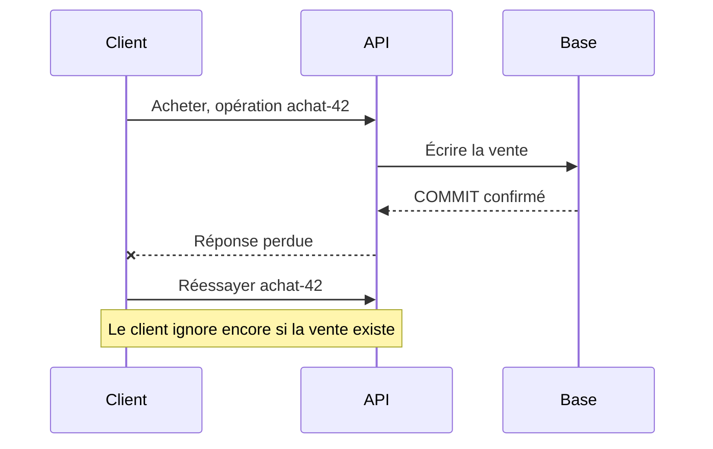

# 00 — Les fondations : raisonner avant de choisir un outil

## Objectifs

À la fin de cette introduction, tu dois pouvoir suivre une requête entre un téléphone, un serveur et une base, distinguer un échec certain d'un résultat inconnu, et formuler une propriété vérifiable. Il suffit de connaître les fonctions, les conditions et les variables ; SQL et HTTP sont introduits ci-dessous.

## Une requête n'est pas une opération instantanée

Quand tu cliques sur « acheter », le navigateur envoie un message HTTP. Un serveur vérifie ton identité, consulte des données, applique une règle et renvoie un résultat. Chacune de ces étapes prend du temps. D'autres requêtes peuvent s'intercaler. Le réseau peut transporter la demande mais perdre la réponse.



**Un timeout signifie « je ne sais pas »**, pas forcément « rien ne s'est passé ». Cette idée relie idempotence, résilience, sagas et consensus.

## Les trois questions d'une conception

1. **Quel invariant protéger ?** Par exemple : le nombre de billets vendus ne dépasse pas la capacité ; chaque écriture comptable a une contrepartie ; Alice ne voit jamais une facture de Bob.
2. **Quelles pannes couvrir ?** Double clic, crash de processus, base inaccessible, panne de disque, partition réseau, document malveillant, opérateur qui déploie un mauvais schéma.
3. **Quel service dégradé accepter ?** Mise en attente, refus temporaire, lecture ancienne signalée, revue humaine. Une réponse rapide et incorrecte n'est pas toujours préférable à un refus explicite.

Une garantie repose sur des hypothèses. « Persisté » suppose un stockage disponible et correctement configuré. « Répliqué » ne signifie pas « sauvegardé ». « Testé avec 100 clients » ne signifie pas « supporte 2 millions d'utilisateurs ».

## HTTP et SQL nécessaires

Une API expose des opérations, par exemple `POST /orders` et `GET /orders/42`. Le serveur déduit l'identité d'une session ou d'un jeton vérifié. Le corps de la requête décrit la demande ; il ne prouve pas les droits du demandeur.

Codes utiles : `200/201` pour un résultat obtenu, `202` pour un travail durablement accepté mais inachevé, `401` pour une authentification absente/invalide, `403` pour un accès interdit, `404` pour une ressource absente ou volontairement masquée, `409` pour un conflit métier, `412` pour une précondition de version invalide, `429` pour une limitation et `503` pour une indisponibilité temporaire.

SQL manipule des tables. Une clé primaire identifie une ligne. Une contrainte `UNIQUE` empêche un doublon ; `CHECK` impose une règle locale. Les valeurs variables doivent être liées à des paramètres, jamais concaténées dans du SQL.

```sql
BEGIN;
UPDATE stock SET quantity = quantity - 1
WHERE product_id = 42 AND quantity > 0;
-- Vérifier le nombre de lignes modifiées avant de créer la vente.
COMMIT;
```

Une transaction regroupe des modifications. **Atomicité** : toutes ou aucune. **Cohérence** : les règles définies sont préservées si elles sont correctement codées. **Isolation** : les transactions concurrentes respectent le niveau choisi. **Durabilité** : les commits survivent aux pannes couvertes par la configuration. ACID ne vérifie pas tout seul les règles que tu as oublié d'écrire.

## Pourquoi les dix défis se recouvrent

La concurrence concerne des opérations différentes qui se chevauchent ; l'idempotence concerne les répétitions d'une même intention. La résilience concerne la réaction aux pannes ; la fiabilité métier concerne le résultat global attendu. La scalabilité peut amplifier les problèmes de concurrence. Un déploiement peut produire temporairement deux versions de l'application. La synchronisation et le consensus répondent à des besoins différents de partage des données.

## Petit exercice corrigé

Une réservation prend 200 ms. Le navigateur attend 100 ms puis réessaie. Peut-on conclure que la première tentative a échoué ? **Non.** Elle peut encore être en cours ou déjà validée. Il faut retrouver la même intention par un identifiant stable et consulter son état.

Deux serveurs utilisent chacun un verrou en mémoire. Protègent-ils le même stock ? **Non.** Le verrou doit agir sur l'autorité commune, généralement une transaction dans la base, ou un protocole distribué adapté.

Avant de poursuivre, explique avec tes mots : transaction, invariant, timeout, doublon et résultat inconnu. Puis lance `python3 -m pocs.run 01a` depuis la racine.
