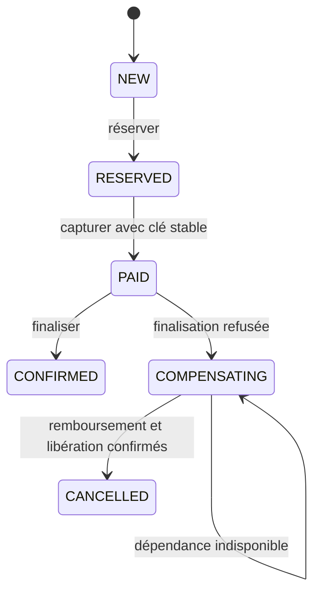

# 06 — Fiabilité métier : paiement, stock et commande doivent se rejoindre

## Objectifs et prérequis

Comprendre les écritures doubles, transmettre durablement les événements et orchestrer une saga récupérable. Prérequis : cours 01, 02 et 03. Durée indicative : 8 à 12 h.

## Une opération métier traverse plusieurs autorités

Dans un monolithe utilisant une base, stock et commande peuvent souvent partager une transaction. Avec trois services autonomes, un paiement peut réussir pendant que le service de commandes est indisponible. Chaque service voit une partie du monde.

L'objectif n'est pas d'affirmer que tout arrive exactement au même instant. Il faut représenter les états intermédiaires, garantir la traçabilité de chaque effet et ramener les opérations vers un état métier autorisé dès que les dépendances et les mécanismes de reprise fonctionnent.

**Invariants :** aucun effet de paiement sans identifiant rapprochable ; aucune commande confirmée sans ses préconditions ; une réservation libérée ne doit pas être consommée ensuite sans nouvel arbitrage. Une commande bloquée doit rester visible et exploitable.

## Outbox : ne pas perdre l'intention de publier

Écrire une commande dans sa base puis publier un événement au broker crée deux étapes : un crash entre elles laisse une commande sans événement. Publier avant commit permet l'inverse : un événement sur une commande annulée.

L'outbox écrit l'objet métier et l'événement à publier dans **la même transaction locale**. Un relais publie ensuite. Si le relais tombe après publication mais avant marquage, il republiera. Le consommateur doit donc être idempotent, par exemple avec une inbox. [Description du pattern par Chris Richardson](https://microservices.io/patterns/data/transactional-outbox.html).

## POC A — Commande et livraison

**Code :** [p06a_outbox.py](../pocs/p06a_outbox.py). **Ressources :** deux bases SQLite indépendantes ; publication simulée par un appel local.

```bash
python3 -m pocs.run 06a
```

Un premier crash avant insertion dans l'outbox annule aussi la commande. Une seconde tentative valide les deux. Le relais livre, puis perd son accusé de traitement. À la reprise, l'inbox du destinataire empêche une deuxième livraison. Résultat : deux tentatives de publication, une livraison créée et aucune entrée en attente.

**Extension réelle :** PostgreSQL + relais de polling ou CDC + broker durable. Debezium propose un routeur d'événements d'outbox basé sur la capture de changements. [Documentation Debezium](https://debezium.io/documentation/reference/stable/transformations/outbox-event-router.html). Tester arrêt du relais, redélivrance, événement invalide et ordre des événements d'une même commande. Plusieurs relais demandent un mécanisme de réclamation des travaux ; l'ordre doit être explicite par agrégat/version.

## Saga : une suite durable avec compensations

Une saga représente un processus métier :



Une compensation n'est pas un rollback ACID global. Un remboursement peut prendre du temps ou échouer ; des effets comme une livraison physique ne sont pas automatiquement annulables. Privilégier, lorsque le contrat le permet, réservation et autorisation de paiement avant capture définitive.

## POC B — Saga de commande récupérable

**Code :** [p06b_saga.py](../pocs/p06b_saga.py). **Ressources :** trois bases : commandes, réservations, paiements ; un seul orchestrateur.

```bash
python3 -m pocs.run 06b
```

Premier scénario : le prestataire local capture puis l'orchestrateur tombe avant d'enregistrer la réponse. À la reprise, la même clé retrouve la capture et la commande finit `CONFIRMED` avec un seul paiement.

Second scénario : la finalisation est refusée et le remboursement est temporairement indisponible. L'état reste `COMPENSATING`. Une reprise rembourse, libère la réservation puis passe à `CANCELLED`. L'échec de compensation reste donc observable.

**Extension réelle :** trois API et un moteur de workflow durable, par exemple Temporal. Son historique aide à reprendre un workflow ; les activités externes doivent toujours être conçues pour les répétitions. [Documentation Temporal](https://docs.temporal.io/workflows). Ajouter timeouts, états inconnus, backoff, expiration des réservations et rapprochement périodique avec le prestataire.

## Limites et choix d'architecture

Le POC saga n'implémente ni vrai réseau, ni arbitrage de plusieurs orchestrateurs, ni capacité de stock, ni ordre de messages ; il isole la reprise et la compensation. La version réelle exige des transitions conditionnelles, des identifiants d'opération durables et une gestion de tous les échecs métier.

La transaction distribuée 2PC est une autre option lorsque tous les participants la supportent ; elle impose un couplage et des compromis de disponibilité. Une saga convient aux étapes longues avec compensations définies. Une transaction locale reste préférable lorsque la séparation en services n'apporte pas de valeur concrète.

## Vérifier la fiabilité

Injecter une panne avant et après **chaque** effet et chaque sauvegarde d'état. Suivre l'âge de l'outbox, des commandes en attente et des compensations, ainsi que le nombre de paiements sans commande rapprochée. Prévoir une procédure humaine pour les cas non résolus.

Exercice : si le remboursement a échoué, peut-on afficher « annulé et remboursé » ? **Non ; afficher l'état réel, conserver la reprise et alerter selon le délai.** Livrable : machine à états, matrice de pannes et preuve de convergence après rétablissement.
