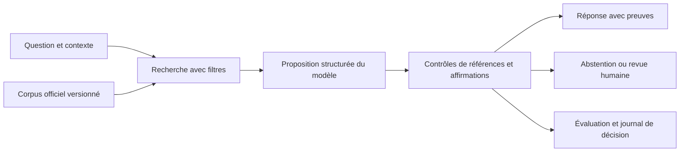

# 09 — Fiabilité de l'IA : des affirmations traçables et une abstention utile

## Objectifs et prérequis

Distinguer existence d'une source, exactitude d'une citation, pertinence et validité d'une interprétation ; concevoir un système qui refuse lorsque les preuves manquent. Prérequis : API, sécurité, tests et lecture du cours 00. Durée indicative : 10 à 14 h.

## Le problème dépasse l'article inventé

Un modèle peut inventer une référence, citer correctement un texte abrogé, appliquer une loi du mauvais pays ou tirer une conclusion que le passage cité ne justifie pas. Le ton assuré et une sortie JSON valide ne fournissent pas de preuve. Une recherche documentaire augmentant la génération, ou **RAG**, réduit certains risques sans les supprimer.

**Invariant produit :** toute affirmation présentée comme établie est associée à une preuve examinable dans le périmètre de validation annoncé. Une interprétation reste étiquetée comme telle. Une preuve insuffisante déclenche une abstention ou une revue, pas une réponse fabriquée.

Les exemples de ce dépôt utilisent exclusivement un **univers juridique fictif**. Ils ne donnent aucune règle de droit applicable à une personne réelle.

## Architecture proposée



**Ingestion :** sélectionner les autorités du pays concerné, conserver identifiant canonique, titre, texte, dates de validité, version, URL officielle, date de collecte et empreinte du contenu. Distinguer loi, jurisprudence, commentaire et document interne. Une empreinte détecte une modification ; elle ne prouve pas à elle seule l'autorité de la source.

**Recherche :** demander juridiction, date des faits et contexte nécessaire. Filtrer par droits d'accès, pays et version avant classement. Combiner recherche lexicale et vectorielle lorsque cela aide ; la similarité d'un embedding n'est pas un certificat juridique.

**Génération :** produire une liste d'affirmations, chacune avec ses références et extraits, plus les hypothèses et questions non résolues. Le modèle ne choisit pas librement des URL à afficher : les liens viennent du registre documentaire validé.

**Validation :** vérifier l'identifiant, le passage exact, la période applicable, la portée et le lien entre preuve et affirmation. Une source existante peut ne pas soutenir la conclusion. Dans un domaine ouvert, l'analyse de ce lien reste faillible : revue qualifiée pour les interprétations sensibles, évaluation sur cas expertisés et affichage des limites.

Pour une extension française, Légifrance fournit un accès API via PISTE et des données ouvertes. Il faut examiner les modalités, quotas et métadonnées du corpus utilisé. [Légifrance — données et API](https://www.legifrance.gouv.fr/contenu/pied-de-page/open-data-et-api). Ce choix de source est un exemple ; aucun pays n'est présumé pour l'utilisateur du futur produit.

## POC A — Vérifier les références avant affichage

**Code :** [p09a_references.py](../pocs/p09a_references.py). **Ressources :** deux documents fictifs, Python ; aucun LLM ni réseau.

```bash
python3 -m pocs.run 09a
```

Le contrôle accepte une référence connue avec un extrait exact, dans la juridiction et la période attendues. Il refuse un article inventé, une citation modifiée, un autre pays et une date hors validité. La borne de fin est exclusive dans ce schéma de démonstration.

**Extension réelle :** corpus provenant d'une source officielle, PostgreSQL pour métadonnées et versions, stockage des documents et index de recherche. Ajouter une tâche de mise à jour, une alerte sur corpus trop ancien et un test où un article change de version. Une panne de recherche doit être distinguée d'une recherche valide sans résultat.

Le champ `trusted` du POC est une fixture contrôlée par le développeur. En production, la provenance exige un pipeline d'ingestion et des permissions ; le modèle ne peut pas se déclarer lui-même fiable.

## POC B — S'abstenir malgré une citation plausible

**Code :** [p09b_abstention.py](../pocs/p09b_abstention.py). **Ressources :** sept propositions synthétiques et une correspondance affirmation/preuve revue manuellement.

```bash
python3 -m pocs.run 09b
```

Une réponse factuelle autorisée est acceptée. Absence de preuve, référence inventée, conclusion fausse avec vraie citation, instruction malveillante et réponse partiellement étayée conduisent à l'abstention. Une interprétation est envoyée en revue humaine. Seuls les champs validés sont rendus ; le texte libre du modèle n'est jamais affiché directement.

**Extension réelle :** brancher un générateur LLM derrière cette interface et conserver un jeu de référence expertisé, distinct des cas utilisés pour régler le système. Ajouter faits contradictoires, textes anciens, corpus indisponible, questions hors périmètre et documents contenant des instructions adverses. Mesurer précision des citations, proportion d'affirmations étayées, faux refus, fausses acceptations, latence et coût par réponse acceptée.

Une liste d'affirmations approuvées est adaptée à ce minuscule domaine fermé ; elle ne généralise pas au droit ouvert. Sept cas réussis ne signifient pas 100 % de fiabilité. Un second LLM peut aider à détecter des erreurs, mais ses erreurs peuvent être corrélées avec celles du premier.

## Sécurité documentaire et exploitation

Traiter les documents récupérés comme des données, jamais comme des instructions d'outil. Limiter les permissions, isoler les sources par utilisateur, contrôler les sorties et tester les injections indirectes. [Guide OWASP sur l'injection de prompt](https://cheatsheetseries.owasp.org/cheatsheets/LLM_Prompt_Injection_Prevention_Cheat_Sheet.html).

Versionner corpus, prompts, modèle, règles de validation et résultats d'évaluation. Documenter les risques résiduels et la responsabilité de la revue. Le profil NIST sur l'IA générative fournit un cadre plus large de gestion des risques. [NIST AI 600-1](https://www.nist.gov/publications/artificial-intelligence-risk-management-framework-generative-artificial-intelligence).

Exercice : « l'article existe » suffit-il ? **Non : il peut être inapplicable ou ne pas soutenir la conclusion.** Livrable : schéma de preuve par affirmation, protocole d'abstention, jeu d'évaluation et exemples de refus expliqués.
