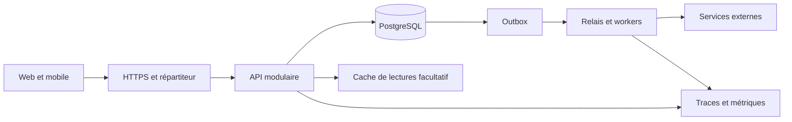

# Choisir les technologies en fonction de la garantie

## Une architecture de départ raisonnable

Pour transformer les POC en projet, commencer par une **API modulaire et PostgreSQL**, avec des responsabilités séparées dans le code. Ajouter une file et des workers pour les travaux longs. Ajouter des services indépendants lorsque leur autonomie, leur rythme de livraison ou leur charge le justifie.

Le parcours utilise Python pour la lisibilité. Pour la version HTTP, FastAPI avec un serveur ASGI constitue une option cohérente avec ce langage. Il faut prendre en compte processus, redémarrage, mémoire, HTTPS et réplication ; le framework ne prend pas toutes ces décisions à ta place. [Concepts de déploiement FastAPI](https://fastapi.tiangolo.com/deployment/concepts/). Les principes étudiés restent applicables à TypeScript/Node.js, Go, Java ou .NET.

## Ce que signifie « serveur moderne »

| Élément | Responsabilité | Ne résout pas automatiquement |
|---|---|---|
| Reverse proxy / répartiteur | TLS, routage, limites d'entrée | Autorisation métier, transaction |
| Serveur applicatif | Exécuter l'API, gérer les connexions | Cohérence entre plusieurs instances |
| Worker | Exécuter les tâches asynchrones | Déduplication des effets |
| Conteneur | Emballer un programme et son environnement | Haute disponibilité, stockage durable |
| Service de conteneurs géré | Déployer et répliquer avec moins d'administration | Budget de connexions et cohérence métier |
| Kubernetes | Orchestrer des workloads, sondes et remplacements | Correction du code, sauvegardes et SLO |
| Fonction à la demande | Exécuter un traitement court déclenché par événement | Absence de doublons, latence stable, coût toujours inférieur |

Choisir le plus petit système permettant de tenir les contraintes. Une VM ou un service géré peut convenir au démarrage. Kubernetes devient utile quand ses capacités répondent à des besoins concrets et que l'équipe peut en assurer l'exploitation.

L'asynchronisme améliore l'utilisation des ressources pendant les attentes d'entrée/sortie. Il ne rend pas un calcul CPU gratuit. Les calculs coûteux peuvent demander des processus, des workers ou un service spécialisé.

## Choisir le stockage

| Besoin | Point de départ | Questions à poser |
|---|---|---|
| Stock, commandes, comptes | PostgreSQL transactionnel | Invariants, verrous, isolation, sauvegarde |
| Apprentissage local ou données embarquées | SQLite | Concurrence d'écriture et accès réseau |
| Lectures dérivées rapides | Cache local ou partagé | Invalidation, TTL, fuite entre utilisateurs |
| Documents volumineux | Stockage objet + métadonnées en base | Version, droits, intégrité et rétention |
| Recherche de proximité sémantique | Index vectoriel, éventuellement pgvector | Qualité, filtrage et rappel |
| Données multi-régions fortement coordonnées | Base distribuée à garanties vérifiées | Latence, quorum, placement et prix |

La recherche vectorielle est une capacité de recherche, pas une source de vérité. pgvector ajoute cette capacité à PostgreSQL ; décider entre recherche exacte et index approximatif selon les mesures de rappel et de latence. [Dépôt officiel pgvector](https://github.com/pgvector/pgvector).

## Les outils à introduire progressivement

| Étape | Outils possibles | Condition d'introduction |
|---|---|---|
| Fondations | Python, SQLite, tests standard | Comprendre les mécanismes sans infrastructure |
| Première API | API HTTP, PostgreSQL, migrations | Besoin de clients réseau et données partagées |
| Travail différé | Outbox, broker ou table de jobs | Tâches longues et reprise durable |
| Workflow long | Temporal ou machine à états persistée | Étapes, timers et compensations nombreux |
| Collaboration hors ligne | Yjs pour le type de document adapté | Politique de fusion définie |
| IA documentaire | Corpus versionné, recherche, générateur, validation | Sources et critères d'abstention explicites |
| Exploitation | Conteneurs, CI, sondes, traces, métriques | Reproduire et observer les déploiements |

La version précise des dépendances devra être fixée dans un fichier de verrouillage lors de l'extension correspondante. Les POC actuels n'en installent aucune. Éviter d'ajouter tous les outils dès le début.

## Observabilité commune aux vingt expériences

Chaque requête ou opération possède un identifiant corrélable. Les logs racontent les transitions ; les métriques indiquent fréquence, durée et saturation ; les traces montrent les passages entre services. OpenTelemetry définit des signaux et mécanismes d'instrumentation pour cette visibilité. [Documentation des signaux](https://opentelemetry.io/docs/concepts/signals/).

Conserver surtout les métriques métier : billets sur-vendus, paiements inconnus, compensations anciennes, accès interdits, conflits hors ligne, affirmations IA rejetées. Des services tous « verts » peuvent encore produire des commandes incohérentes.

Définir les objectifs avec le produit : disponibilité d'une consultation, délai de confirmation d'une commande, durée de reprise d'un export. Un pourcentage sans population, période et définition du succès ne permet pas de vérifier quoi que ce soit.
